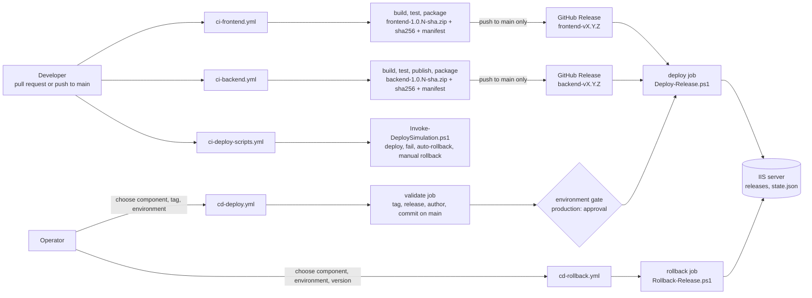
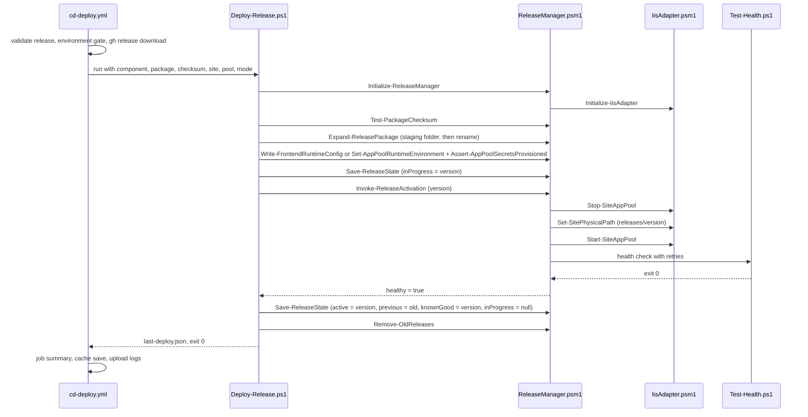
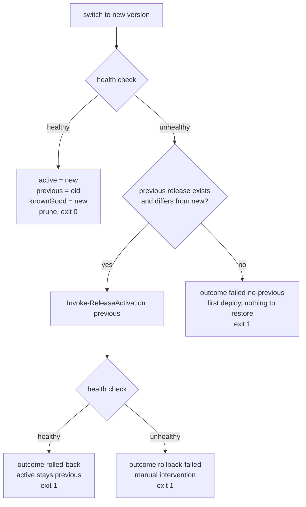
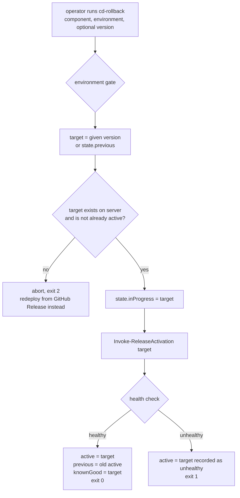

# Architecture walkthrough

A guided tour of the pipeline for a live walkthrough: what runs when, which file calls which, and where
state lives. Each section stands on its own, so jump to whatever the conversation needs.

**Contents**
1. [The whole flow in one picture](#1-the-whole-flow-in-one-picture)
2. [Responsibility table](#2-responsibility-table)
3. [File call trees](#3-file-call-trees)
4. [Function relationships](#4-function-relationships)
5. [A normal deployment, step by step](#5-a-normal-deployment-step-by-step)
6. [Automatic rollback vs manual rollback](#6-automatic-rollback-vs-manual-rollback)
7. [state.json](#7-statejson)
8. [Mock IIS vs real IIS](#8-mock-iis-vs-real-iis)
9. [Security and reliability controls](#9-security-and-reliability-controls)

---

## 1. The whole flow in one picture



Two rules make the picture simple: **CI never deploys, CD never builds**. The GitHub Release is the
handoff between them, and a release only ever comes from a build of `main`.

---

## 2. Responsibility table

### Workflows

| File | Trigger | Responsibility |
|---|---|---|
| [ci-frontend.yml](../.github/workflows/ci-frontend.yml) | PR + push to `main`, paths `frontend/**` | Node 24, `npm ci`, advisory audit, Vitest, `ng build`, version + manifest + zip + sha256, artifact; on `main`: GitHub Release |
| [ci-backend.yml](../.github/workflows/ci-backend.yml) | PR + push to `main`, paths `backend/**`, `global.json` | .NET 10 SDK, locked restore (advisories as errors), build, xUnit, publish, version + manifest + zip + sha256, artifact; on `main`: GitHub Release |
| [ci-deploy-scripts.yml](../.github/workflows/ci-deploy-scripts.yml) | PR + push to `main`, paths `deploy/**` | Runs the full lifecycle simulation on a hosted runner; publishes the final `state.json` to the job summary and uploads transcripts |
| [cd-deploy.yml](../.github/workflows/cd-deploy.yml) | manual (`workflow_dispatch`) | Validates the release, applies the environment gate, downloads the release, runs `Deploy-Release.ps1`, reports; persists mock state between runs |
| [cd-rollback.yml](../.github/workflows/cd-rollback.yml) | manual (`workflow_dispatch`) | Applies the environment gate, runs `Rollback-Release.ps1` against a release already on the server, reports |

### PowerShell files

| File | Kind | Responsibility |
|---|---|---|
| [Deploy-Release.ps1](../deploy/Deploy-Release.ps1) | script (entry point) | Orchestrates one deployment: checksum, extract, configure, preflight, switch, health, automatic rollback, state, prune. Exit 0 / 1 / 2. |
| [Rollback-Release.ps1](../deploy/Rollback-Release.ps1) | script (entry point) | Orchestrates a manual switch to a release already on the server: validate target, switch, health, state. Exit 0 / 1 / 2. |
| [Test-Health.ps1](../deploy/Test-Health.ps1) | script (called by the module) | Single definition of "healthy": HTTP 200 with retries in Iis mode; entry-file check with version-targeted failure injection in Mock mode. Exit 0 / 1. |
| [ReleaseManager.psm1](../deploy/ReleaseManager.psm1) | module (shared logic) | Layout, `state.json`, atomic extraction, config, preflight, `Invoke-ReleaseActivation`, retention. Imports the adapter; scripts import only this module. |
| [IisAdapter.psm1](../deploy/IisAdapter.psm1) | module (infrastructure) | The only code that talks to IIS: physical path, app pool start/stop, app-pool variables. Two implementations selected by `-Mode Mock` or `-Mode Iis`. |
| [Invoke-DeploySimulation.ps1](../deploy/Invoke-DeploySimulation.ps1) | script (test harness) | Plays operations and the pipeline: builds fake packages, provisions mock secrets, runs deploy and rollback through the real entry points, asserts exit codes and state. |

---

## 3. File call trees

### 3.1 CI for a component (frontend shown, backend identical in shape)

```
Pull request or push to main changing frontend/** (or manual trigger)
│
└── ci-frontend.yml
    │
    ├── job: build-test-package  (ubuntu-24.04, permissions: contents read)
    │   ├── actions/checkout            pinned SHA
    │   ├── actions/setup-node          Node from frontend/.nvmrc, npm cache keyed by lockfile
    │   ├── npm ci                      exact lockfile install
    │   ├── npm audit (advisory)        production dependencies only, non-blocking
    │   ├── npx ng test --watch=false   Vitest, once, exit code fails the job
    │   ├── npx ng build                dist/frontend/browser (includes public/web.config)
    │   ├── Compute version             MAJOR.MINOR from VERSION + run number + short SHA
    │   ├── Package                     manifest.json into the output, zip, sha256
    │   └── actions/upload-artifact     7 days (PR) / 30 days (main)
    │
    └── job: publish-release  (push to main only, permissions: contents write)
        ├── actions/download-artifact   same run, automatic token
        └── gh release create           tag frontend-vX.Y.Z at the exact commit, idempotent
```

### 3.2 CI for the deployment engine

```
Push / PR changing deploy/** (or manual trigger)
│
└── ci-deploy-scripts.yml
    │
    └── EXECUTES Invoke-DeploySimulation.ps1 -WorkRoot $RUNNER_TEMP/deploy-simulation -KeepWorkRoot
        │
        ├── Create fake ZIP packages 1.0.1, 1.0.2, 1.0.3 (Api.dll + manifest.json + sha256)
        ├── IMPORT IisAdapter.psm1   (playing operations)
        │   └── Set-AppPoolEnvironmentVariable ConnectionStrings__Default   (name is what matters)
        │
        ├── EXECUTES Deploy-Release.ps1
        │   ├── Deploy 1.0.1            first deploy, no previous
        │   ├── Deploy 1.0.2            previous = 1.0.1
        │   └── Deploy unhealthy 1.0.3  MOCK_UNHEALTHY_VERSION=1.0.3
        │       └── automatic rollback to 1.0.2, exit 1, outcome rolled-back
        │
        ├── EXECUTES Rollback-Release.ps1
        │   ├── Manual rollback to previous (1.0.1)
        │   └── Roll forward to 1.0.2
        │
        ├── EXECUTES Deploy-Release.ps1
        │   └── Required variable Jwt__SigningKey missing -> preflight abort, exit 2, nothing switched
        │
        └── Assert exit codes and state.json after every step
            └── 0 failed expectations -> exit 0 -> workflow green; otherwise red
        │
        ├── Job summary: final state.json
        └── Artifact: state.json + logs/ transcripts
```

### 3.3 CD deploy

```
Operator: Run workflow (component, release_tag, environment, simulate_failure)
│
└── cd-deploy.yml
    │
    ├── job: validate  (ubuntu-24.04, full checkout)
    │   ├── tag matches <component>-vX.Y.Z
    │   ├── gh release view        exists, not draft, author github-actions
    │   └── git merge-base         tag commit is an ancestor of main
    │
    └── job: deploy  (environment = input; runs-on = DEPLOY_RUNNER_LABEL or ubuntu-24.04)
        ├── environment protection   production waits for a reviewer
        ├── actions/checkout         sparse: deploy/ only
        ├── Resolve deploy root      Mock: $RUNNER_TEMP/deploy-root, Iis: vars.DEPLOY_ROOT
        ├── actions/cache/restore    mock only: previous mock server state
        ├── IMPORT IisAdapter.psm1   mock + backend only: provision required variable names (playing operations)
        ├── gh release download      zip + sha256 by tag
        ├── EXECUTES Deploy-Release.ps1 @params      (see section 5)
        ├── Write job summary        from last-deploy.json + state.json   (always)
        ├── actions/cache/save       mock only                           (always)
        └── actions/upload-artifact  logs/                               (always)
```

### 3.4 CD rollback

```
Operator: Run workflow (component, environment, target_version optional)
│
└── cd-rollback.yml
    │
    └── job: rollback  (same environment gate, same concurrency group as deploys)
        ├── actions/checkout         sparse: deploy/ only
        ├── Resolve deploy root
        ├── actions/cache/restore    mock only
        ├── EXECUTES Rollback-Release.ps1 @params   (see section 6)
        ├── Write job summary        from last-rollback.json + state.json   (always)
        ├── actions/cache/save       mock only                             (always)
        └── actions/upload-artifact  logs/                                 (always)
```

---

## 4. Function relationships

### 4.1 Who imports and calls whom

```
Deploy-Release.ps1 ─┐
Rollback-Release.ps1 ┼── Import-Module ──► ReleaseManager.psm1 ── Import-Module (nested) ──► IisAdapter.psm1
                     │                            │                                              │
                     │                            └── & Test-Health.ps1 (child process-like call,  │
                     │                                 exit code = health)                        │
Invoke-DeploySimulation.ps1                                                                       │
   ├── & Deploy-Release.ps1 / & Rollback-Release.ps1   (as the pipeline)                          │
   └── Import-Module IisAdapter.psm1                   (as operations, same mock files) ──────────┘

cd-deploy.yml  ── Import-Module IisAdapter.psm1 (mock provisioning step) ── & Deploy-Release.ps1
cd-rollback.yml ─────────────────────────────────────────────────────────── & Rollback-Release.ps1
```

Scripts never call the adapter directly for deployment work: everything infrastructure-related goes
through `ReleaseManager`, which owns the one adapter instance. The two places that import the adapter
directly are deliberately "operations", not "pipeline": they provision variable names in the mock the
way an operations team would on a real server.

### 4.2 Where the important functions are defined and called

| Function | Defined in | Called by | Does |
|---|---|---|---|
| `Initialize-ReleaseManager` | ReleaseManager.psm1 | both scripts | stores the mode, calls `Initialize-IisAdapter` |
| `Get-ComponentLayout` | ReleaseManager.psm1 | both scripts | computes `releases/`, `logs/`, `state.json` paths, creates folders |
| `Get-ReleaseState` / `Save-ReleaseState` | ReleaseManager.psm1 | both scripts | read `state.json`; write it atomically (temp file + move) |
| `Add-StateHistory` | ReleaseManager.psm1 | both scripts | appends `{at, action, version, result, detail}` |
| `Test-PackageChecksum` | ReleaseManager.psm1 | Deploy-Release.ps1 | SHA-256 of the zip must equal the `.sha256` file |
| `Expand-ReleasePackage` | ReleaseManager.psm1 | Deploy-Release.ps1 | extract to `staging-<guid>`, read manifest, rename to `releases/<version>`; refuses a different commit under the same version |
| `Write-FrontendRuntimeConfig` | ReleaseManager.psm1 | Deploy-Release.ps1 (frontend) | writes `config.json` with the public API base URL |
| `Set-AppPoolRuntimeEnvironment` | ReleaseManager.psm1 | Deploy-Release.ps1 (backend) | sets `ASPNETCORE_ENVIRONMENT` via `Set-AppPoolEnvironmentVariable` |
| `Assert-AppPoolSecretsProvisioned` | ReleaseManager.psm1 | Deploy-Release.ps1 (backend) | fails fast if a required variable **name** is missing, via `Get-AppPoolEnvironmentVariableNames` |
| **`Invoke-ReleaseActivation`** | ReleaseManager.psm1 | Deploy-Release.ps1 (forward **and** automatic rollback), Rollback-Release.ps1 | `Stop-SiteAppPool` -> `Set-SitePhysicalPath` -> `Start-SiteAppPool` -> `Test-Health.ps1`; returns healthy true/false |
| `Remove-OldReleases` | ReleaseManager.psm1 | Deploy-Release.ps1 (success only) | deletes `staging-*` leftovers and old releases, never active / previous / knownGood |
| `Initialize-IisAdapter` | IisAdapter.psm1 | ReleaseManager, simulation, cd-deploy mock step | Mock: creates `sites/` and `apppools/` JSON store. Iis: imports `WebAdministration` |
| `Get/Set-SitePhysicalPath` | IisAdapter.psm1 | `Invoke-ReleaseActivation` | Mock: JSON file. Iis: `Get-Website` / `Set-ItemProperty IIS:\Sites\<name> physicalPath` |
| `Stop/Start-SiteAppPool` | IisAdapter.psm1 | `Invoke-ReleaseActivation` | Mock: JSON state. Iis: `Stop-WebAppPool` / `Start-WebAppPool` + wait for the state |
| `Get-AppPoolEnvironmentVariableNames` / `Set-AppPoolEnvironmentVariable` | IisAdapter.psm1 | preflight, runtime environment, operations steps | Mock: JSON. Iis: `*-WebConfigurationProperty` on `applicationHost.config`. Logs names, never values |

`Invoke-ReleaseActivation` is the heart of the design: deploy, automatic rollback and manual rollback are
the same three IIS operations plus the same health check, so there is exactly one definition of
"activate a release and verify it".

---

## 5. A normal deployment, step by step



In words, with the reason for the order:

1. **Checksum** before anything else: the bytes must be the bytes CI produced.
2. **Extract next to the active release**, never into it, via a staging folder that is renamed only when
   complete. The active release keeps serving.
3. **Configure** the new folder (frontend `config.json`) or the app pool (`ASPNETCORE_ENVIRONMENT`), then
   **preflight**: required secret names must exist. A deploy that cannot start fails here, with nothing switched.
4. **Record intent**: `inProgress = version`. From here on, a crash leaves evidence.
5. **Switch**: stop pool, repoint, start pool.
6. **Verify**: health check with retries, because a freshly started pool needs a moment.
7. **Commit the outcome** to `state.json`, prune old releases, write `last-deploy.json` for the workflow summary.

---

## 6. Automatic rollback vs manual rollback

### 6.1 Automatic rollback (inside Deploy-Release.ps1)



Triggered by the pipeline itself, immediately, with no human involved. The job is red in every failure
branch because the requested deploy did not happen, even when the environment ends up healthy.

### 6.2 Manual rollback (Rollback-Release.ps1 via cd-rollback.yml)



Triggered by a human, gated like a deploy, and able to target **any** release still on the server, which
also makes it the roll-forward mechanism. No download and no extraction: it only moves the physical path.

| | Automatic | Manual |
|---|---|---|
| Trigger | failed health check inside a deploy | operator runs `cd-rollback` |
| Target | the release that was active before the deploy | `state.previous` or any version on the server |
| Approval | none needed (already inside an approved deploy) | environment gate applies |
| Download | none | none |
| Shared code | `Invoke-ReleaseActivation` | `Invoke-ReleaseActivation` |
| Record | `last-deploy.json`, history `deploy failed` + `auto-rollback` | `last-rollback.json`, history `rollback` |

---

## 7. state.json

**Where**: `<DeployRoot>/<component>/state.json`, one per component per server. In the assessment the
deploy root is `$RUNNER_TEMP/deploy-root` on the hosted runner, persisted between runs with
`actions/cache` so consecutive runs see the same "server". On a real server it is simply a file on disk.

**Shape**:

```json
{
  "component": "backend",
  "active": "1.0.8",
  "previous": "1.0.6",
  "knownGood": "1.0.8",
  "inProgress": null,
  "history": [
    { "at": "...", "action": "deploy",        "version": "1.0.6", "result": "success", "detail": "commit f4219c6..." },
    { "at": "...", "action": "deploy",        "version": "1.0.8", "result": "success", "detail": "commit 5e51b42..." },
    { "at": "...", "action": "deploy",        "version": "1.0.6", "result": "failed",  "detail": "health check failed" },
    { "at": "...", "action": "auto-rollback", "version": "1.0.8", "result": "success", "detail": "" }
  ],
  "updatedAt": "..."
}
```

| Field | Meaning | Changed by |
|---|---|---|
| `active` | the release the site points at, as last confirmed healthy | deploy success, rollback (success or recorded unhealthy) |
| `previous` | the release that was active before the last switch; default rollback target | deploy success, rollback success |
| `knownGood` | last release that passed a health check on this server | deploy success, rollback success only |
| `inProgress` | version being switched right now; non-null after a crash means "a switch started and was never confirmed" | set before activation, cleared after the outcome is recorded |
| `history` | append-only audit trail | every deploy, auto-rollback and rollback |

**Who reads and writes it**

```
Get-ReleaseState / Save-ReleaseState   (ReleaseManager.psm1, atomic write: temp file then move)
    ├── Deploy-Release.ps1      read at start, write inProgress, write outcome
    ├── Rollback-Release.ps1    read at start, write inProgress, write outcome
    ├── Remove-OldReleases      read: active / previous / knownGood are never deleted
    ├── cd-deploy.yml / cd-rollback.yml   read for the job summary
    └── Invoke-DeploySimulation.ps1       read for assertions
```

---

## 8. Mock IIS vs real IIS

Same orchestration, two adapter implementations, selected by `-Mode`:

| Operation | Mock (`DEPLOY_MODE=Mock`, this assessment) | Real (`DEPLOY_MODE=Iis`) |
|---|---|---|
| Site physical path | `_iis-mock/sites/<site>.json` | `Get-Website`, `Set-ItemProperty IIS:\Sites\<site> -Name physicalPath` |
| App pool stop / start | `_iis-mock/apppools/<pool>.json` state | `Stop-WebAppPool` / `Start-WebAppPool`, wait for `Stopped` / `Started` |
| App pool variables | JSON map in the pool file | `Get/Set/Add-WebConfigurationProperty` on `applicationHost.config` |
| Health check | entry file present (`Api.dll` / `index.html`), `MOCK_UNHEALTHY_VERSION` forces failure | `Invoke-WebRequest` to `API_HEALTH_URL` / `FRONTEND_HEALTH_URL`, expects 200 |
| Runner | `ubuntu-24.04` (hosted), PowerShell 7 preinstalled | self-hosted Windows runner selected by `DEPLOY_RUNNER_LABEL` |
| Deploy root | `$RUNNER_TEMP/deploy-root`, persisted with `actions/cache` | `DEPLOY_ROOT` per environment, e.g. `D:\apps\prod` |
| Runtime secrets | provisioned by a mock step in the workflow (names only matter) | provisioned on the server by operations |

**What changes to go to production**: install IIS, the .NET 10 Hosting Bundle and URL Rewrite; create the
two sites and pools; install and register the self-hosted runner (private repo, runner group, service
account, `gh` CLI); set `DEPLOY_RUNNER_LABEL` and `DEPLOY_MODE=Iis`; provision the app-pool secrets. No
workflow or script changes.

---

## 9. Security and reliability controls

| Control | Mechanism | Where |
|---|---|---|
| Least privilege | `permissions: contents: read` everywhere; `contents: write` only in `publish-release` | all workflows |
| Immutable actions | every `uses:` pinned to a commit SHA; Dependabot keeps them current | all workflows, `dependabot.yml` |
| Reproducible builds | `npm ci` + lockfile; `dotnet restore --locked-mode` + `packages.lock.json` | CI workflows |
| Vulnerability gates | NU1903/NU1904 as build errors (backend); advisory `npm audit` (frontend) | `Directory.Build.props`, `ci-frontend.yml` |
| No pipeline secrets | only `GITHUB_TOKEN`; runtime secrets live on the server; preflight checks names only | all workflows, `Assert-AppPoolSecretsProvisioned` |
| No script injection | expressions mapped through `env:`, never interpolated into `run:` | all workflows |
| Clean artifacts | dev settings removed; manifest hidden from browsers; no environment config inside | `ci-backend.yml`, `frontend/public/web.config` |
| Release authenticity | tag pattern, non-draft, author = CI bot, commit on `main` | `cd-deploy.yml` validate job |
| Release integrity | SHA-256 verified before extraction | `Test-PackageChecksum` |
| Protected history | rulesets: `release-tags` (no delete/update), `protect-main` (PR only, no force push) | repository settings |
| Gated production | environment with required reviewer, `main` only | repository settings, `environment:` in CD |
| Deployment lock | concurrency group per component and environment, never cancel in progress | both CD workflows |
| Atomic state and folders | staging folder renamed into place; `state.json` written via temp file + move | `ReleaseManager.psm1` |
| Immutable releases on disk | same version with a different commit is refused | `Expand-ReleasePackage` |
| Known-good protection | prune never deletes active / previous / knownGood | `Remove-OldReleases` |
| Evidence | transcripts per run, `last-deploy.json` / `last-rollback.json`, job summaries, simulation artifacts | scripts and workflows |

For the risk-by-risk discussion see [security.md](security.md); for the server-side design see
[deployment-design.md](deployment-design.md).
