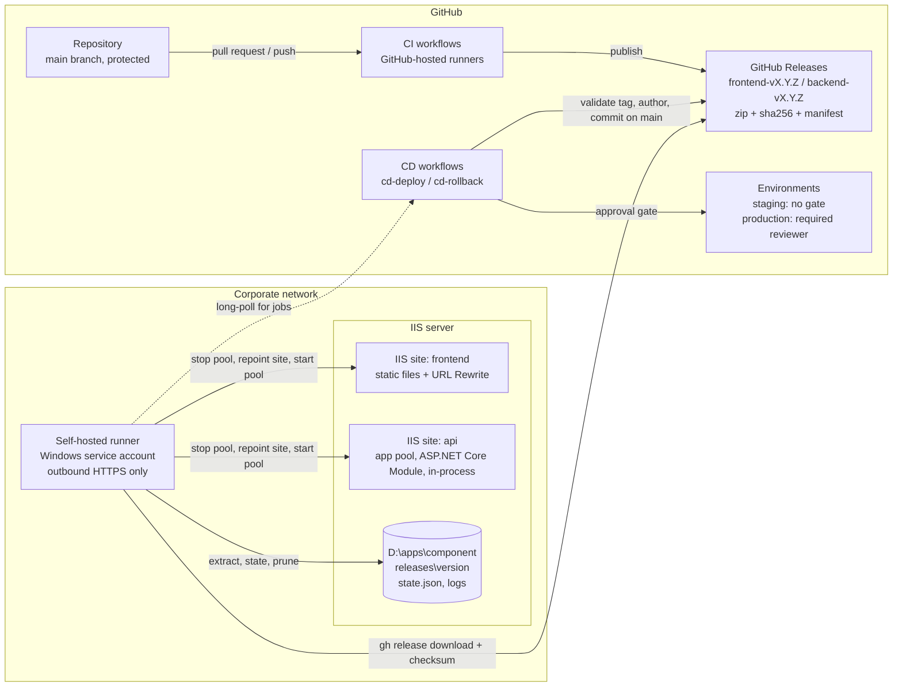
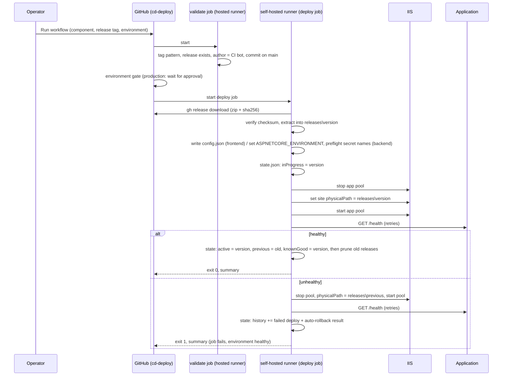

# On-premises deployment design

This document explains how the pipeline deploys the Angular frontend and the .NET 10 API to a Windows
server running IIS, how the server is reached securely, how releases are laid out, and how rollback and
recovery work. It also states which parts are implemented, simulated, or documented in this assessment.

## Architecture



The only connection between GitHub and the server is initiated by the runner, outbound over HTTPS.
No inbound port is opened, no VPN from GitHub exists, and no server credential is stored in GitHub: the
runner's Windows service account is the deployment identity.

## Deployment sequence



## Server layout

```
D:\apps\<component>\
  releases\1.0.6\          one immutable folder per release (extracted zip, manifest.json inside)
  releases\1.0.8\
  state.json               active / previous / knownGood / inProgress / history
  logs\                    one transcript per deploy or rollback run
```

The IIS site's physical path points at the active release folder. A deployment never writes into the
folder that is serving traffic: the new release is extracted next to it, and the switch is a change of
the physical path between a stop and a start of the app pool. Rolling back is the same operation
towards the previous folder. `Get-Website` on the server shows which release is live; `state.json`
records the history.

## Hosting model

- **API**: its own IIS site and application pool ("No Managed Code"). The ASP.NET Core Module v2,
  installed by the .NET Hosting Bundle, runs `dotnet Api.dll` in-process inside the IIS worker process,
  as declared in the `web.config` that `dotnet publish` generates into the artifact. The build is
  framework-dependent and platform-neutral, so a zip built on a Linux runner runs unchanged on Windows.
- **Frontend**: a separate IIS site serving static files. Its `web.config` (shipped inside the build
  output from `frontend/public/`) rewrites unknown paths to `index.html` for client-side routing,
  sets long cache lifetimes for hashed bundles and no caching for `index.html`, and hides
  `manifest.json` from browsers.
- **Configuration**: environment-specific, non-secret values arrive as GitHub variables scoped per
  environment. The API receives `ASPNETCORE_ENVIRONMENT` as an app-pool environment variable; the
  frontend receives `config.json` with the public API base URL. Runtime secrets are provisioned on the
  server by operations as app-pool environment variables; the deploy only verifies their names exist.
- **Order**: when both components change, deploy the backend first, then the frontend, because the API
  must stay backward compatible with the previous frontend. If the frontend succeeds and the backend
  fails, the backend rolls back alone and the frontend keeps working against the previous API; if the
  new frontend requires the new API, roll the frontend back too.

## Rollback and recovery

| Scenario | Behaviour |
|---|---|
| Health check fails after a switch | Automatic rollback to the previous release, health check again, state records both results, job fails. |
| Operator wants an older release that is still on the server | `cd-rollback` with the version, or empty for the recorded previous. Same approval gate as a deploy. |
| Operator wants a release that was pruned | `cd-deploy` with its tag: the release is permanent on GitHub and is redeployed from there. |
| Deploy interrupted before the switch | The active release is untouched. The next run removes leftover `staging-*` folders and repeats. |
| Deploy interrupted after the switch | `state.json` still holds `inProgress`, which tells the next operator which switch was started and never confirmed. |
| Server unavailable | The self-hosted job stays queued and then times out without touching anything. An unreachable health check triggers the rollback path and the job reports failure. |
| First deploy to a server | There is no previous release; the script says so and reports the failure instead of pretending to roll back. |
| Known-good protection | The prune function never deletes the active, previous or known-good release; release tags on GitHub cannot be deleted or moved. |
| Concurrent operations | One concurrency group per component and environment: a deploy and a rollback never overlap, and a running deploy is never cancelled. |

## Implemented, simulated, documented

| Item | Status |
|---|---|
| CI per component with path filters, tests, versioned artifacts, manifest, checksum | implemented |
| GitHub Releases per main build, protected tags | implemented |
| Release validation (tag, release, author, commit lineage), environment gate, approval | implemented |
| Download of the CI artifact, checksum verification, atomic extraction, state file, history | implemented |
| Switch, health check, automatic rollback, manual rollback, prune | implemented, executed against the mock IIS |
| IIS operations (physical path, app pool, app-pool variables) | implemented in `IisAdapter.psm1`, executed only in Mock mode; real cmdlets reviewed, not run |
| Health check over HTTP | implemented; in Mock mode replaced by a file-based check with version-targeted failure injection |
| Persistence of server state between runs | real server: its disk; assessment: `actions/cache`, skipped on a real runner |
| Self-hosted runner, runner group, service account, Hosting Bundle, URL Rewrite module | documented |
| Runtime secrets provisioned on the server | documented; the preflight that checks their names is implemented |

## What a real rollout needs

1. A Windows server with IIS, the .NET 10 Hosting Bundle and the IIS URL Rewrite module.
2. Two IIS sites and app pools created once (names in the repository variables), with the API pool set to
   "No Managed Code".
3. A self-hosted runner registered to this private repository, in a runner group restricted to it,
   running as a dedicated service account with rights on `D:\apps` and IIS management, and `gh` installed.
4. The repository variable `DEPLOY_RUNNER_LABEL` set to that runner's label and `DEPLOY_MODE` set to `Iis`.
5. Runtime secrets provisioned on the API's app pool by operations (names listed in `API_REQUIRED_VARIABLES`).
6. A team of approvers on the `production` environment with "Prevent self-review" enabled.
